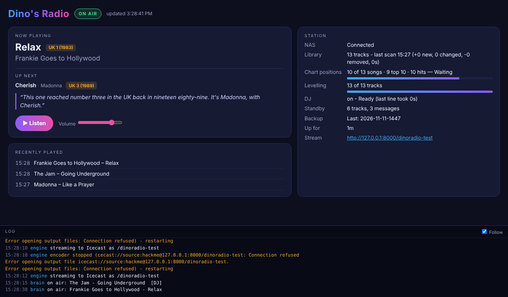

# Dino's Radio

**Your own music library as a non-stop internet radio station, on a Raspberry Pi.**

Dino's Radio plays the music on your NAS as a continuous radio station, with a DJ voice
that introduces the hits, crossfades between songs, and even volume across old and new
recordings. It streams MP3 through Icecast, so you can listen on an Amazon Echo (through a
simple Alexa skill), a web browser, VLC, or any internet-radio player.



## What it does

- **A hits-first mix.** Chart positions are looked up on Wikipedia, and every song is placed in
  one of three groups. By default 50% of songs are UK/US top 10 hits, 35% charted at 11–100,
  and 15% are album tracks or songs that didn't chart. No song repeats within 3 days, and no
  artist within 15 songs.
- **A DJ.** A natural British voice ([Piper](https://github.com/rhasspy/piper), entirely on the
  Pi) talks over the start of a song with the music dipped underneath. For example: *"Here's
  a UK number one from nineteen eighty-four…"*. The DJ always introduces top 10 hits, often
  other chart hits, and now and then everything else.
- **Voiced ahead of time.** The radio chooses the next 6 songs in advance and voices the DJ's
  lines in the background, so nothing ever waits for the voice. Each song's introduction is
  always worded the same way, so it's voiced once and kept (on the USB drive if there is one).
  In quiet moments it voices the introductions for the biggest hits in your library ahead of time.
  If a line isn't ready in time, that song plays without a link. That's how a slow,
  high-quality voice works even on a Raspberry Pi 2.
- **The weather, once an hour.** At a random time each hour (7am–10pm by default), the DJ reads
  the weather for your town before a song: what it's doing, the temperature, the wind, and whether
  rain's on the way. It comes from [Open-Meteo](https://open-meteo.com), with no account needed.
- **Never off air.** If the NAS goes away (a reboot, a network drop), the radio switches to
  standby tracks kept on a USB stick. The DJ says *"Sorry, we're having a little trouble
  reaching the record library… please hold"* now and then. When the music comes back, the DJ
  says *"And we're back!"*.
- **Looks after itself.** It checks for new or changed music every 15 minutes and checks every
  file once a night. It starts by itself when the Pi powers up.
- **Status page** at `http://<the Pi>:8080`. It shows what's on now, what's next and what the
  DJ will say, plus progress, recently played, a **Listen** button and the live log.
- **Nightly backup** to a USB stick. Rebuilding the Pi restores everything, including its fixed
  IP address, with no rescan of your library.

## What you need

- A **Raspberry Pi 2** or newer, wired to your network. It was developed on a Pi 2 Model B. The
  original Pi 1 is too slow.
- **Raspberry Pi OS Lite** (Trixie), 32- or 64-bit, with SSH turned on.
- Your music on a **NAS or Windows share** (SMB), in MP3, FLAC, M4A, OGG, Opus or WAV. A
  read-only user for the share is best.
- A **USB stick** (1 GB or more; 8 GB lets it keep plenty of standby tracks), formatted FAT32,
  exFAT, NTFS or ext4. It's optional, but recommended for backups and standby tracks.
- Internet access while installing, to download the software and the DJ voice.

## Install

1. Put **Raspberry Pi OS Lite** on an SD card with Raspberry Pi Imager. In its settings, set the
   hostname (e.g. `dinoradio`), turn on SSH and create a user.
2. Boot the Pi on a network cable, plug in the USB stick, and connect with SSH (PuTTY on Windows).
3. Run:

   ```bash
   curl -L https://github.com/axelthefatcat/dinoradio/archive/refs/heads/main.tar.gz | tar xz
   cd dinoradio-main
   sudo bash install.sh
   ```

4. Answer the questions: station name, NAS address, share and folder, NAS user name and
   password, and which USB stick to use. It then takes 20–30 minutes on a Pi 2. At the end it
   shows your **stream address** (e.g. `http://192.168.1.50:8000/radio-k3x9q2…`) and the
   **status page** address.

The first time, it reads the whole library (allow up to an hour for ~12,000 tracks). Chart
positions take about a day and volume levels a few days, filling in quietly in the background.
Until the charts are in, the mix sounds more random.

> **Tip:** give the Pi a fixed IP address, so your players and the Alexa skill always find it.
> On Raspberry Pi OS Trixie, check the connection's name with
> `nmcli -t -f NAME,DEVICE connection show`, then:
> `sudo nmcli connection modify netplan-eth0 ipv4.method manual ipv4.addresses 192.168.1.50/24 ipv4.gateway 192.168.1.1 ipv4.dns 192.168.1.1 && sudo nmcli connection up netplan-eth0`

## Day to day

Open **`http://<the Pi>:8080`** in any browser on your network for the status page. Or, over SSH:

| Command | What it does |
|---|---|
| `dinoradio status` | What's on air, what's next, and progress |
| `dinoradio skip` | Skip the current song |
| `dinoradio say "text"` | The DJ says something over an upcoming song |
| `dinoradio weather` | The DJ reads the weather over an upcoming song |
| `dinoradio rescan` | Look for new music now (`rescan full` checks every file) |
| `dinoradio standby on` / `off` | Test standby mode |
| `dinoradio fill-standby 25` | Copy 25 more songs to the standby folder |
| `dinoradio backup` | Back up now |
| `dinoradio settings` | Edit the settings, then restart |
| `update-radio` | Update to the latest version from GitHub |
| `dinoradio log` | Watch what it's doing (Ctrl+C to stop) |
| `dinoradio stream` | Show the stream address |

All the settings are in `/etc/dinoradio/settings.toml`. That includes the mix percentages, how
often the DJ talks, the DJ voice (`en_GB-cori-medium`, or the clearer but much slower `en_GB-cori-high`; run
`update-radio` after changing it), the weather town, crossfade length, levelling, Christmas songs (December only by default),
genres to leave out, and the standby and backup options. `dinoradio settings` opens the file
and offers to restart afterwards.

## Updating

Over SSH on the Pi, from any folder:

```bash
update-radio
```

It downloads the latest version from GitHub and runs the installer. An install from before
`update-radio` existed needs updating the long way once:

```bash
cd ~ && rm -rf dinoradio-main
curl -L https://github.com/axelthefatcat/dinoradio/archive/refs/heads/main.tar.gz | tar xz
cd dinoradio-main && sudo bash install.sh
```

The installer recognises an existing station and doesn't ask its questions again. Your
settings, stream address, chart positions, volume levels, play history and standby tracks are
all kept. To change the NAS details or the station name, run
`sudo bash install.sh --reconfigure` instead.

## Backup and restore

**What's backed up:** every night at 3am, the radio backs up everything it has learnt to the
USB stick, in a `dinoradio` folder:
- the track list, chart positions, volume levels and play history
- your settings, including the stream address
- the "please hold" messages
- the Pi's network settings, including its fixed IP address

The standby tracks already live on the stick. Seven nights are kept. The NAS password isn't
backed up, so you'll type it again on a rebuild.

- **Back up now:** `dinoradio backup`. The result shows in `dinoradio status` and on the
  status page.
- **Added a USB stick after installing?** Run `sudo bash install.sh --usb`.
- **Rebuilding the Pi** (new SD card, or a new Pi):
  1. Install as normal, with the USB stick plugged in.
  2. The installer finds the latest backup and offers to restore it.
  3. After restoring, it offers to put the fixed IP address back. Your SSH session then drops,
     so reconnect on the old address.
  The station carries on with the same stream address, so players and the Alexa skill keep
  working, and there's no full rescan.
- **Go back to last night's backup** on a working Pi: `sudo bash install.sh --restore`.

If the stick isn't plugged in, the nightly backup is skipped, and the status shows why, rather
than quietly filling the SD card. A few standby tracks are also kept on the SD card in case
the stick is ever missing.

## Listening on an Amazon Echo

An Echo needs an **HTTPS** address for a stream. Put a reverse proxy in front of the Pi's
Icecast. A Synology NAS can do this in **Control Panel › Login Portal › Advanced › Reverse
Proxy**, sending `https://radio.your-domain` to `http://<the Pi>:8000`. Then use
`https://radio.your-domain/<stream mount>` as the stream URL in a simple Alexa skill (an
AudioPlayer skill that plays one stream). There's a step-by-step guide, with the skill code, at
[echo-home-stream](https://github.com/axelthefatcat/echo-home-stream).

The stream mount (`radio-…`) is random and works like a password, so keep it private. The
installer hides it from Icecast's public status pages. Don't
put the status page (port 8080) on the internet. It has no login and is meant for your home
network.

## Troubleshooting

| Problem | What to do |
|---|---|
| Status says **STANDBY** | The Pi can't read the music. Check the NAS is on, then `dinoradio log`. It reconnects by itself, and you can force it with `sudo mount -a`. |
| **NOT STREAMING** | Icecast isn't running: `sudo systemctl restart icecast2 dinoradio`. |
| No DJ | `dinoradio status` shows why. The voice needs internet access once, during install. |
| The DJ is quiet after changing the voice | Every line is voiced again in the new voice. `dinoradio status` shows progress under *Voiced ahead*; with `en_GB-cori-high` on a Pi 2, it takes two or three days to voice the introductions for the top 10 hits, and the DJ talks more and more as they fill in. |
| Chart lookups paused | Wikipedia asked it to slow down. It waits and carries on by itself, from 10 minutes up to 6 hours. |
| Swapped the USB stick's contents on a PC | Put it back in, then `sudo mount -a` (or reboot). |

## How it's built

- **Language and libraries:** Python 3, with NumPy for mixing and Mutagen for tags.
- **Audio:** FFmpeg decodes the music, measures loudness (EBU R128) and encodes the stream.
- **Streaming:** Icecast serves the stream.
- **Data:** a SQLite database holds the library, charts and history.
- **Services:** one systemd service runs the radio; `install.sh` sets everything up.

Chart data comes from Wikipedia (CC BY-SA). Weather data comes from Open-Meteo (CC BY 4.0). The DJ voice is Piper (MIT) with the
`en_GB-cori-medium` voice, downloaded from the Piper voices collection during install.
